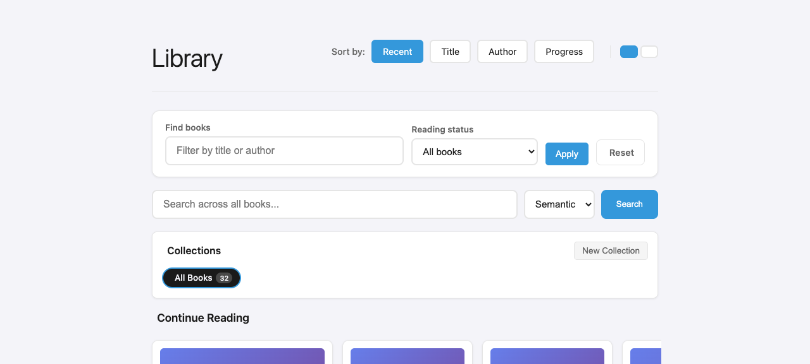
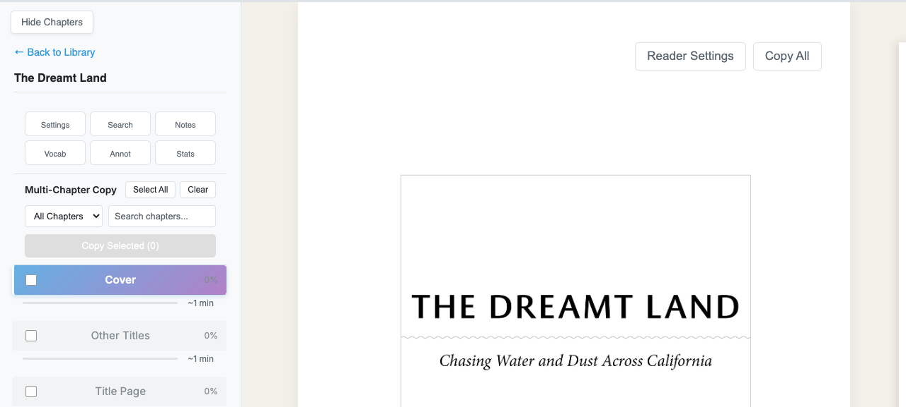

# Reader3

A lightweight, self-hosted EPUB & PDF reader for reading books.

## Features

- **EPUB & PDF Reader**: Clean reading interface with progress persistence and Table of Contents navigation.
- **Chapter & Section Copying**: Single-tap and batch chapter copying from EPUBs with markdown/heading formatting.
- **PDF Image Copying**: Copy single pages or multi-page composites to clipboard and native share sheet.
- **Library Shelf**: Automatic cover art extraction for EPUB and PDF documents.
- **Android App**: Standalone mobile release with offline library ([download `reader3.apk`](reader3.apk)).

## Screenshots





## Local setup

Requirements:

- Python 3.12+
- `uv`

Install dependencies:

```bash
uv sync
```

Run locally:

```bash
uv run python launcher.py
```

The app opens in your browser. Upload a book to start reading.

## PDF rendering settings

New PDF imports render display pages as 200 DPI JPEG and lazy-load them. The copy/export pipeline keeps full-resolution PNG output. Override the defaults with environment variables:

| Variable | Default | Description |
| --- | --- | --- |
| `PDF_PAGE_IMAGE_FORMAT` | `jpeg` | `jpeg` or `png` for display pages |
| `PDF_PAGE_IMAGE_DPI` | `200` | Display-page resolution |
| `PDF_PAGE_IMAGE_QUALITY` | `88` | JPEG quality for display pages |
| `PDF_COPY_IMAGE_DPI` | `300` | Default clipboard/export resolution |
| `PDF_RENDER_MAX_DIMENSION` | `8192` | Maximum width/height of a rendered copy page |
| `PDF_RENDER_MAX_PIXELS` | `40000000` | Maximum pixel area of a rendered copy page |

Existing PDFs keep their current page images until they are reprocessed.

## Tests

```bash
uv run python -m pytest -q
```

## Build

```bash
uv run --extra build python build_executable.py
```

PyInstaller is installed only with the `build` extra. HTTPX and pytest are test
dependencies. To refresh the deployment requirements after a dependency update:

```bash
uv export --no-dev --no-emit-project --format requirements-txt --output-file requirements.txt
```

## Notes

- Local app data is stored in the book directory.
- `launcher.py` is the simplest way to run the app in development.

## License

MIT
